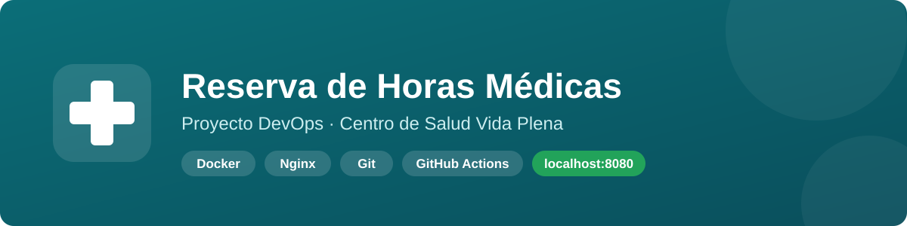
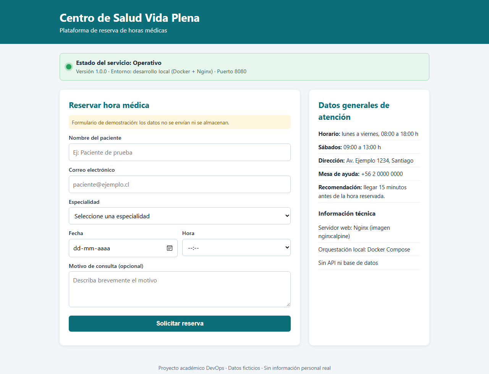
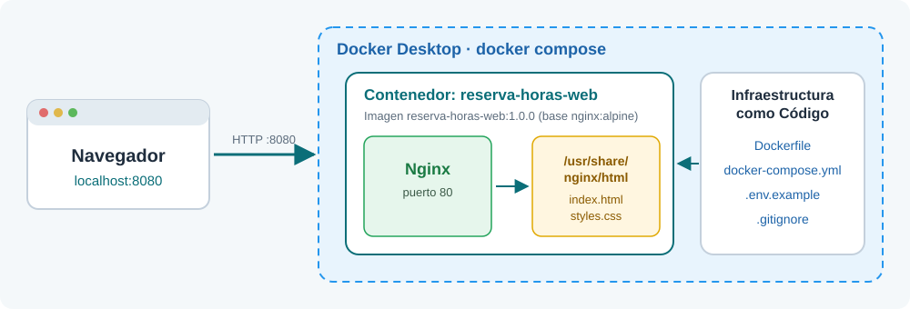
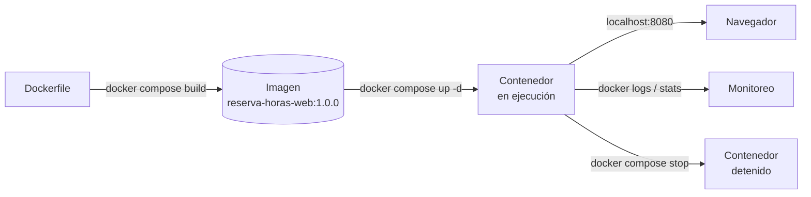
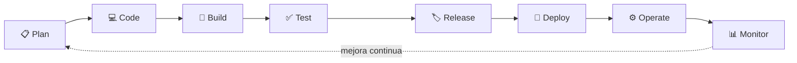
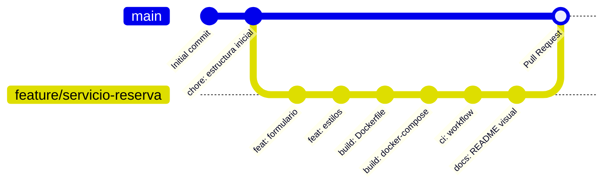
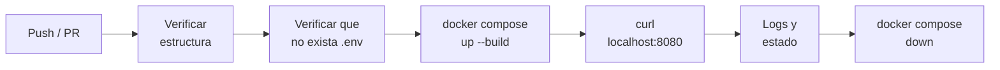

<p align="center">
  
</p>

<p align="center">
  
  
  
  
  
  <a href="https://github.com/jsalloc1-design/reserva-horas-devops/actions"></a>
</p>

<p align="center">
  Servicio web estático de <b>reserva de horas médicas</b> para una empresa del rubro salud,
  servido con <b>Nginx</b> dentro de un contenedor <b>Docker</b> y ejecutado localmente con
  <b>Docker Compose</b> en <code>http://localhost:8080</code>.
</p>

> [!NOTE]
> Proyecto académico (asignatura DevOps, IACC). El "Centro de Salud Vida Plena" es ficticio.
> No contiene API, base de datos, credenciales reales ni datos personales.

---

## 🖥️ Vista previa

<p align="center">
  
</p>

La página incluye:

| Sección | Descripción |
|---|---|
| 🟢 **Estado del servicio** | Indicador "Operativo" con versión, entorno y puerto. |
| 📝 **Formulario de reserva** | Nombre, correo, especialidad, fecha, hora y motivo. Es una simulación: no envía ni guarda datos. |
| 🏥 **Datos de atención** | Horarios, dirección, mesa de ayuda y recomendaciones. |

---

## 🏗️ Arquitectura

<p align="center">
  
</p>

El navegador consulta `localhost:8080`, Docker publica ese puerto hacia el puerto `80` del contenedor
y Nginx entrega los archivos estáticos. Todo el entorno está definido como **Infraestructura como Código**
(`Dockerfile` + `docker-compose.yml`), por lo que se reproduce igual en cualquier equipo con Docker.

---

## 📁 Estructura del proyecto

```text
reserva-horas-devops/
├── src/
│   ├── index.html              # Formulario, datos de atención y estado del servicio
│   └── styles.css              # Hoja de estilos responsiva
├── docs/img/                   # Imágenes del README
├── Dockerfile                  # Imagen basada en nginx:alpine
├── docker-compose.yml          # Servicio "web" publicado en el puerto 8080
├── .env.example                # Variables de ejemplo (sin valores sensibles)
├── .gitignore                  # Excluye .env, logs, claves y temporales
├── README.md
└── .github/workflows/
    └── devops-automation.yml   # Validación automática (complementaria)
```

---

## 🚀 Inicio rápido

### Requisitos

| Herramienta | Uso |
|---|---|
|  | Clonar el repositorio |
|  | Construir y ejecutar el contenedor (debe estar **iniciado**) |
| 🌐 Navegador web | Verificar el servicio |

### 1. Clonar el repositorio

```bash
git clone https://github.com/jsalloc1-design/reserva-horas-devops.git
cd reserva-horas-devops
```

### 2. Crear el archivo de variables (opcional)

```bash
cp .env.example .env        # Windows PowerShell: copy .env.example .env
```

> [!TIP]
> Si el puerto 8080 está ocupado, cambia `APP_PORT` en el archivo `.env`.

### 3. Construir y levantar el servicio

```bash
docker compose up -d --build
```

### 4. Abrir en el navegador

👉 **http://localhost:8080**

---

## 🔎 Verificación y monitoreo

| Acción | Comando |
|---|---|
| Ver contenedores activos | `docker compose ps` / `docker ps` |
| Probar desde la terminal | `curl -I http://localhost:8080` |
| Revisar logs | `docker logs reserva-horas-web` |
| Ver métricas (CPU, memoria, red) | `docker stats --no-stream` |
| Detener el servicio | `docker compose stop` |
| Detener y eliminar el contenedor | `docker compose down` |

<details>
<summary><b>Ciclo de vida del contenedor</b> (clic para ver)</summary>



</details>

---

## 🔄 Ciclo de vida DevOps



| Fase | En este proyecto | Evidencia |
|---|---|---|
| 📋 **Plan** | Alcance, estructura y tareas en tablero Kanban | README, Issues |
| 💻 **Code** | `index.html` y `styles.css` en rama `feature/*` | Historial de commits |
| 🐳 **Build** | Imagen desde `Dockerfile` (`nginx:alpine`) | `docker compose up --build` |
| ✅ **Test** | Respuesta HTTP 200 en el puerto 8080 | Navegador, `curl`, GitHub Actions |
| 🏷️ **Release** | Pull Request revisado y fusionado a `main` | Pull Request |
| 🚀 **Deploy** | Despliegue local con Docker Compose | Docker Desktop |
| ⚙️ **Operate** | Iniciar, detener y reiniciar el servicio | Comandos `docker compose` |
| 📊 **Monitor** | Revisión de logs y consumo de recursos | `docker logs`, `docker stats` |

---

## 🌿 Flujo de trabajo con Git



- **`main`**: rama estable; solo recibe cambios mediante **Pull Request**.
- **`feature/<nombre>`**: una rama por funcionalidad.
- **Commits convencionales**: `feat:`, `fix:`, `build:`, `ci:`, `docs:`, `chore:`.

---

## 🔒 Seguridad

| Práctica | Cómo se aplica |
|---|---|
| 🚫 Sin credenciales en el código | Las variables se documentan en `.env.example` con valores de ejemplo. |
| 🙈 `.env` fuera de Git | `.gitignore` excluye `.env`, claves (`*.pem`, `*.key`) y logs. |
| 🧪 Datos ficticios | El formulario no envía ni guarda información de pacientes. |
| 📦 Imagen mínima y oficial | `nginx:alpine` reduce el tamaño y la superficie de ataque. |
| 👀 Revisión antes de publicar | `git status` / `git diff` antes de cada commit y revisión en Pull Request. |

> [!WARNING]
> Nunca subas el archivo `.env` ni datos reales de pacientes al repositorio.

---

## ⚙️ Automatización con GitHub Actions

El workflow [`devops-automation.yml`](.github/workflows/devops-automation.yml) se ejecuta en cada
*push* y *Pull Request*:



---

<p align="center">
  Hecho con 💚 por <a href="https://github.com/jsalloc1-design">Joel Sallo</a> · Asignatura DevOps · IACC 2026
</p>
